<h1><picture><source media="(max-width: 1100px) and (prefers-color-scheme: dark)" srcset="docs/assets/readme/title-narrow-dark.svg"><source media="(max-width: 1100px)" srcset="docs/assets/readme/title-narrow-light.svg"><source media="(prefers-color-scheme: dark)" srcset="docs/assets/readme/title-dark.svg"></picture></h1>

**普通の Screen が、人の動きに React する。**

<div align="center">

  [](#実績)
  [](#実績)

  [](./docs/android-specification-v1.md)
  [-000000?style=flat-square&logo=apple&logoColor=white)](./ios/README.md)
  [](./docs/desktop-specification-v1.md)
  [](#技術)
  [](#技術)

  <p>
    <a href="#デモ">デモ</a> ・
    <a href="#screactとは">Screactとは</a> ・
    <a href="#できること">できること</a> ・
    <a href="#利用場面">利用場面</a> ・
    <a href="#技術">技術</a> ・
    <a href="#クイックスタート">クイックスタート</a> ・
    <a href="#ドキュメント">ドキュメント</a>
  </p>
</div>

---

## デモ

<div align="center">
  <a href="https://drive.google.com/file/d/14SZvVKVLxcpKkB3tEl41TTzPK-4H_XEj/view?usp=sharing">
    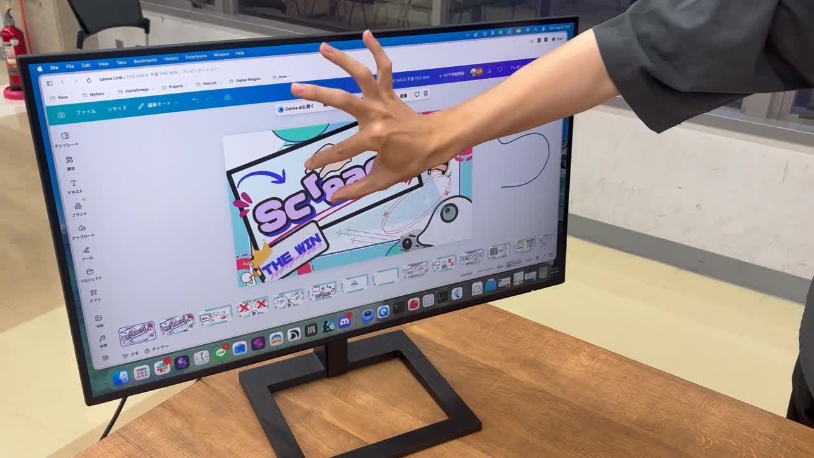
  </a>
  <br>
  <strong><a href="https://drive.google.com/file/d/14SZvVKVLxcpKkB3tEl41TTzPK-4H_XEj/view?usp=sharing">▶ デモ動画を見る（Google Drive・約33秒）</a></strong>
  <br>
  <sub>タッチ機能のない普通のモニターに、手で直接描き込んでいます。スマホの画面には触れていません。</sub>
</div>

## Screactとは

Screact は**タッチ機能のない普通の画面を、そのまま手で操作できるようにする**システムです。

画面の横にスマホを置き、そのカメラを画面の「目」として使います。スマホが手指の動きと画面の位置を認識し、PC へ状態を送ります。PC はそれを画面上の操作に変え、ブラウザ、スライド、PDF など普段のアプリをその場で動かします。

<picture><source media="(max-width: 700px) and (prefers-color-scheme: dark)" srcset="docs/assets/readme/concept-narrow-dark.svg"><source media="(max-width: 700px)" srcset="docs/assets/readme/concept-narrow-light.svg"><source media="(prefers-color-scheme: dark)" srcset="docs/assets/readme/concept-dark.svg">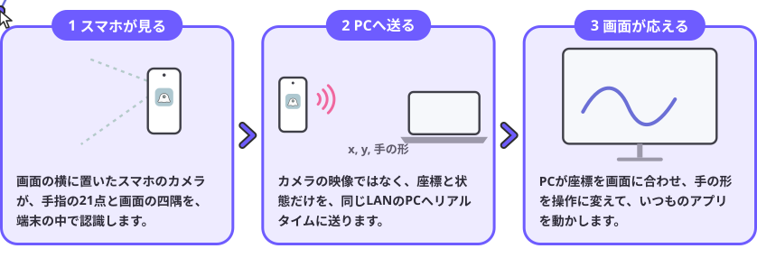</picture>

<p align="center">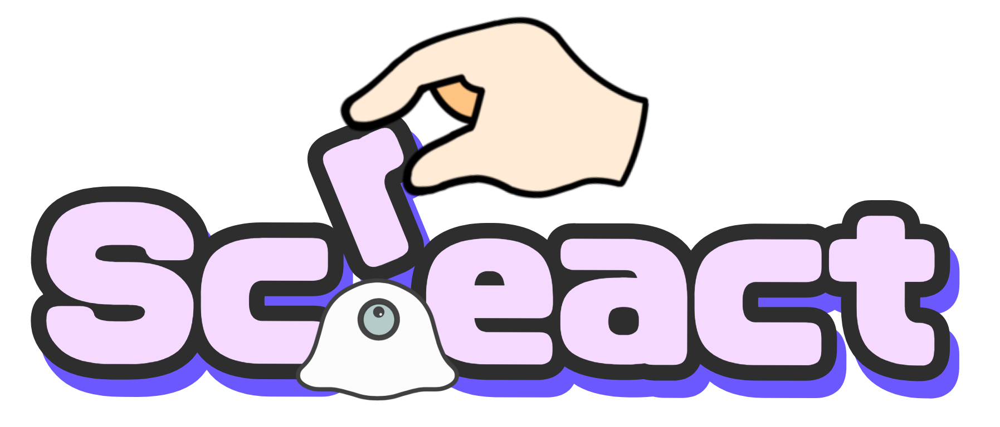</p>

名前は **Screen + React**。表示するだけだった画面が、人の動きに反応する画面へ変わります。ロゴでは、手が「r」をつまみ上げ、その下からアプリのキャラクターの YouRay がのぞいています。

## できること

ハンドジェスチャーを検知し、PC の基本操作を実現します。

<picture><source media="(max-width: 700px) and (prefers-color-scheme: dark)" srcset="docs/assets/readme/gestures-narrow-dark.svg"><source media="(max-width: 700px)" srcset="docs/assets/readme/gestures-narrow-light.svg"><source media="(prefers-color-scheme: dark)" srcset="docs/assets/readme/gestures-dark.svg"></picture>

人差し指を動かすとポインターが動きます。図の線と点は、スマホが実際に認識している手指21点の骨格です。

- 描画は**透明でクリック透過のオーバーレイ**に重ねるため、ブラウザやスライドを隠さずに書き込めます。
- クリック・ドラッグ・スクロールは **OS の実入力**（macOS: CGEvent / Windows: SendInput）として送るため、既存のアプリをそのまま操作できます。
- クリック・ペン・消しゴム・スクロールの有効／無効、骨格表示、描画色、認識感度は Desktop の設定画面で切り替えられます。
- 手を見失ったときや通信が切れたときは、押下中・描画中の状態を自動で解除します。

## 後付けという選択

画面を直接操作する体験は、電子黒板やタッチディスプレイでも得られます。ただし、それには画面の買い替えが必要で、費用も時間もかかります。

Screact は**今ある画面に「操作できる」を後付け**します。

<picture><source media="(max-width: 700px) and (prefers-color-scheme: dark)" srcset="docs/assets/readme/retrofit-narrow-dark.svg"><source media="(max-width: 700px)" srcset="docs/assets/readme/retrofit-narrow-light.svg"><source media="(prefers-color-scheme: dark)" srcset="docs/assets/readme/retrofit-dark.svg">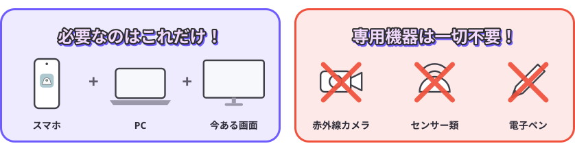</picture>

タッチ対応の画面へ買い替える必要も、設置の工事もいりません。アプリを入れたスマホを持ち運べば、いつでもどこでも使えます。

モニターは教室にも、会議室にも、店舗にもあります。Screact は身の回りにある画面を「操作できる画面」に変えます。

## 利用場面

<picture><source media="(max-width: 700px) and (prefers-color-scheme: dark)" srcset="docs/assets/readme/scenes-narrow-dark.svg"><source media="(max-width: 700px)" srcset="docs/assets/readme/scenes-narrow-light.svg"><source media="(prefers-color-scheme: dark)" srcset="docs/assets/readme/scenes-dark.svg"></picture>

### 直接操作の価値（先行研究）

画面を直接操作することの価値は、HCI や消費者心理の研究でも報告されています。

<picture><source media="(max-width: 700px) and (prefers-color-scheme: dark)" srcset="docs/assets/readme/evidence-narrow-dark.svg"><source media="(max-width: 700px)" srcset="docs/assets/readme/evidence-narrow-light.svg"><source media="(prefers-color-scheme: dark)" srcset="docs/assets/readme/evidence-dark.svg">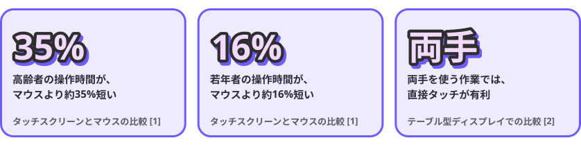</picture>

タッチスクリーンで商品を見たときには、「自分のもの」という感覚が最も強くなり、商品をより高く評価する傾向も報告されています [[3]](#参考文献)。

直接操作すると、操作しやすくなるだけでなく、操作の意図も周りに伝わりやすくなります。

> [!NOTE]
> 上記は一般的な直接操作（タッチスクリーン等）に関する先行研究の結果であり、Screact 自体で測定した効果ではありません。

## 技術

### 処理の流れ

<div align="center">
  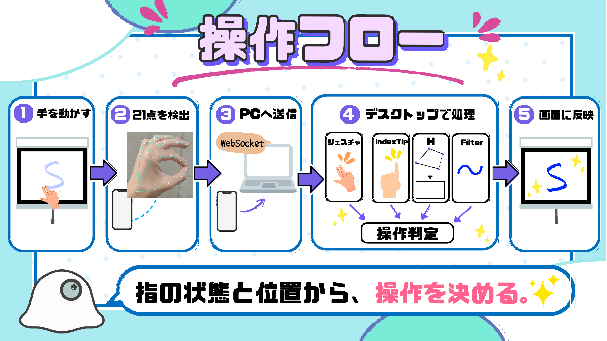
</div>

1. **手を動かす**：画面の前で、いつものように手を動かす
2. **21点を検出**：スマホが MediaPipe で手指の骨格を、ArUco で画面の位置を認識する
3. **PC へ送信**：映像ではなく、座標と状態だけを WebSocket で送る
4. **Desktop で処理**：座標変換、平滑化、ジェスチャー判定で「操作」に変える
5. **画面に反映**：オーバーレイ描画と OS 入力で、既存のアプリに届ける

### 4つのこだわり

「手を認識できる」だけでは、画面を操作できません。Screact は認識から操作までを一つの体験としてつなぐために、次の4点に取り組みました。

<picture><source media="(max-width: 700px) and (prefers-color-scheme: dark)" srcset="docs/assets/readme/focus-narrow-dark.svg"><source media="(max-width: 700px)" srcset="docs/assets/readme/focus-narrow-light.svg"><source media="(prefers-color-scheme: dark)" srcset="docs/assets/readme/focus-dark.svg">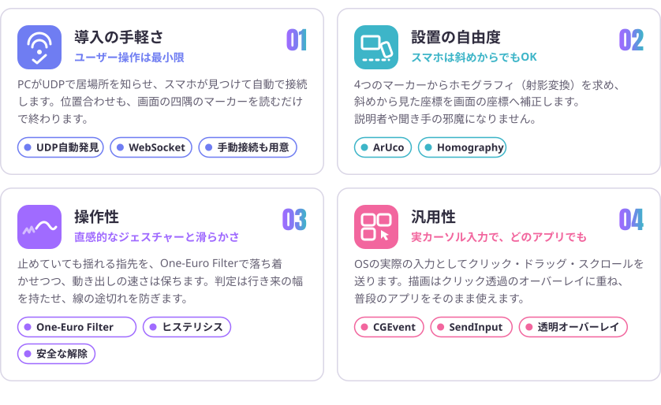</picture>

<details>
<summary><b>4つのこだわりを詳しく</b></summary>

**1. 導入の手軽さ（ユーザー操作は最小限）**

PC が UDP で接続情報を広告し、スマホがそれを見つけて WebSocket で自動接続します。通常は IP アドレスを入力する必要がありません。位置合わせも、PC 画面の四隅に表示した ArUco マーカーをスマホが読み取るだけで完了します。自動検出できないネットワークでは、IP・ポート・6桁コードによる手動接続に切り替えられます。

**2. 設置の自由度（スマホは斜めからでも OK）**

4つのマーカーからホモグラフィ（射影変換）を求め、斜めから見たカメラ座標を画面座標へ補正します。スマホを画面の正面中央に置く必要がないため、説明者や聞き手の邪魔になりません。

**3. 操作性（直感的なジェスチャーと滑らかな動き）**

カメラで捉えた指先は、止めていても細かく揺れます。One-Euro Filter で静止時の揺れを抑えつつ、動き出しの応答性を保ちます。ジェスチャーはヒステリシス付きで判定し、境界でのちらつきや線の途切れを防ぎます。認識はスマホ、操作の判定は PC と処理を分担し、PC 側で操作ロジックを調整しやすくしています。

**4. 汎用性（実カーソル入力で、どのアプリでも）**

専用アプリの中だけで動くのではなく、OS の実入力としてポインター・クリック・ドラッグ・スクロールを送ります。描画はクリック透過のオーバーレイに重ねるため、ブラウザ、スライド、PDF など普段のアプリをそのまま操作できます。

</details>

### 通信

| 通信 | 既定値 | 役割 |
|:--|--:|:--|
| UDP | `8766` | PC の所在、WebSocket ポート、6桁コードをスマホへ知らせる（自動発見専用） |
| WebSocket over TCP | `8765` / `/ws/v1/input` | 認証、位置合わせ、手指21点、状態、制御メッセージ |

手指データは UDP では送りません。カメラ映像も PC へ常時送信しません。メッセージ形式は [通信仕様書 v1](./docs/protocol-specification-v1.md) を参照してください。

### 使用技術

| 領域 | 技術 | 用途 |
|:--|:--|:--|
| Android | Kotlin / Jetpack Compose / CameraX | カメラ、状態別ガイド、接続 |
| iOS（実験的） | SwiftUI / AVFoundation | Android と同じプロトコルのクライアント |
| 手指認識 | MediaPipe Hand Landmarker | 手指21点の検出（既定1手、設定で最大2手） |
| 画面認識 | OpenCV ArUco（`DICT_4X4_50`） | 画面四隅のマーカー検出 |
| Desktop | Flutter / Dart | 接続、位置合わせ、ジェスチャー、描画、設定 |
| 座標処理 | Homography / One-Euro Filter | 画面座標への変換と揺れの低減 |
| 通信 | UDP / WebSocket（OkHttp） | 自動発見とリアルタイム送信 |
| OS 連携 | Swift / CGEvent、C++ / Win32 / SendInput | 透明オーバーレイとネイティブ入力 |

## 画面

<table>
  <tr>
    <th width="50%">Desktop：位置合わせ</th>
    <th width="50%">Android：手の追跡</th>
  </tr>
  <tr>
    <td>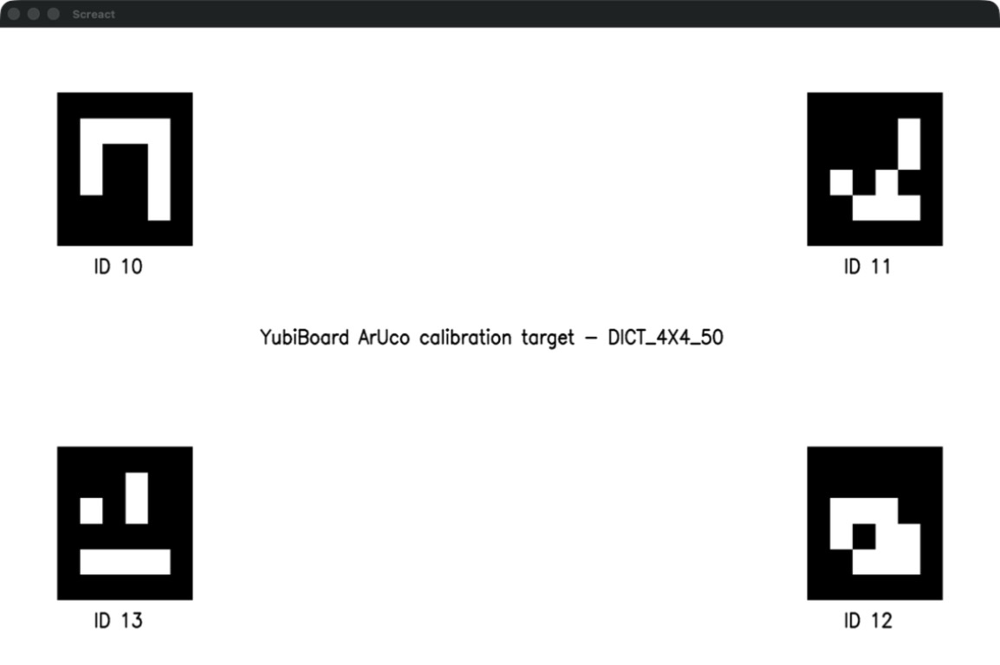</td>
    <td>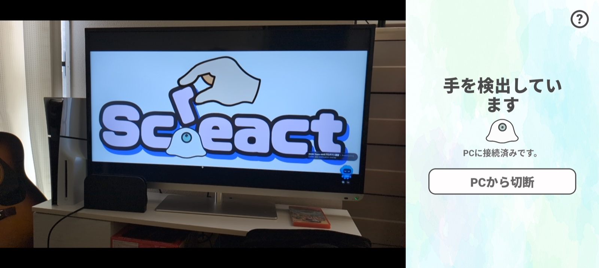</td>
  </tr>
  <tr>
    <th>Desktop：接続</th>
    <th>Android：マーカー検出</th>
  </tr>
  <tr>
    <td>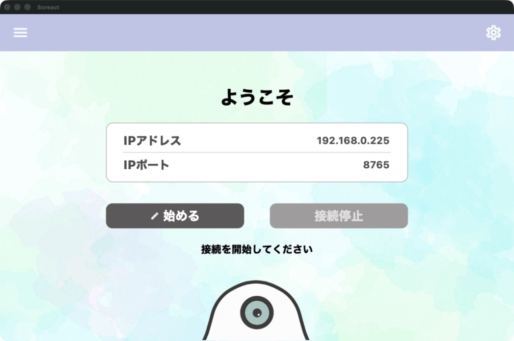</td>
    <td>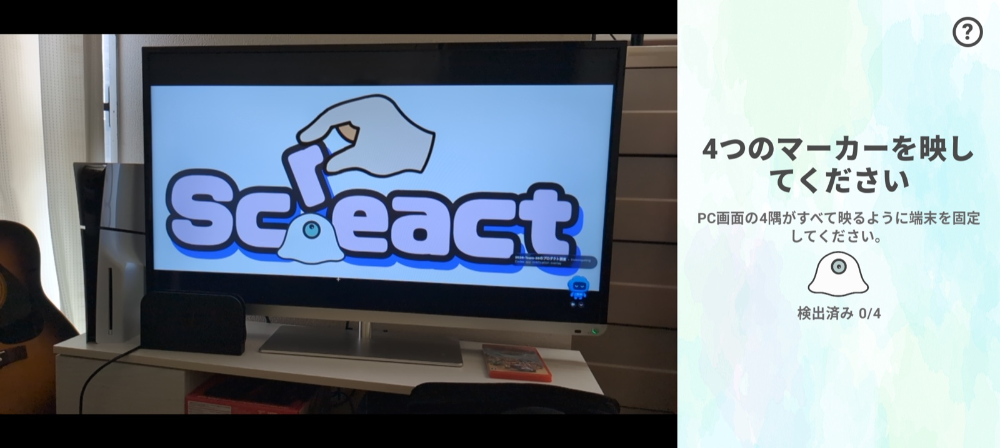</td>
  </tr>
</table>

ほかの画面とフローは [ギャラリー](./docs/gallery.md) にまとめています。

## クイックスタート

### 必要なもの

- Android 7.0（API 24）以上のスマホ（背面カメラ）
- macOS 10.15 以上、または Windows の PC
- スマホと PC が相互に通信できる同一 LAN（Wi-Fi）
- 開発環境: Flutter（Dart SDK `^3.7.2`）、Android Studio（Android SDK 36、JDK 17）
  - macOS: フル版 Xcode
  - Windows: Visual Studio の「Desktop development with C++」

### 1. Desktop アプリを起動する

```bash
cd desktop
flutter pub get
flutter run -d macos     # Windows では -d windows
```

macOS では、初回接続時にローカルネットワークへのアクセスを許可してください。クリックやスクロールを使うには、「システム設定」→「プライバシーとセキュリティ」→「アクセシビリティ」で Screact を許可します。

### 2. Android アプリをインストールする

```bash
cd android
./gradlew assembleDebug          # Windows では .\gradlew.bat assembleDebug
adb install -r app/build/outputs/apk/debug/app-debug.apk
```

Android Studio で開く場合は、リポジトリ全体ではなく `android/` を開いてください。

### 3. つないで、合わせて、操作する

1. PC 画面全体と手が映る位置にスマホを固定する（斜めからでも構いません）
2. スマホで Screact を起動し、「画面認識開始」を押す
3. PC で Screact を起動し、「はじめる」を押す（スマホが PC を見つけて自動接続します）
4. 接続すると PC 画面の四隅に ArUco マーカーが表示され、スマホが読み取って位置合わせを行います
5. 位置合わせが終わると、透明オーバーレイに切り替わります。手で操作を始めてください

自動接続できない場合は、スマホの「手動で接続する（IP・6桁コード）」から、PC 画面に表示された IP、ポート、6桁コードを入力してください。位置合わせをやり直すときは、PC の「位置合わせ」画面から実行できます。

オーバーレイの解除は、macOS ではメニューバーの鉛筆アイコンまたは `⌘⇧O`、Windows では `Ctrl+Shift+O` です。

## 開発

### テスト

```bash
# Desktop
cd desktop
dart format --output=none --set-exit-if-changed lib test
flutter analyze
flutter test

# Android
cd android
./gradlew testDebugUnitTest lintDebug assembleDebug
./gradlew connectedDebugAndroidTest   # 実機またはエミュレーターが必要
```

iOS のビルドとテストは [ios/README.md](./ios/README.md) を参照してください。

### ディレクトリ構成

```text
screact/
├─ android/   # Android アプリ（Kotlin / Jetpack Compose）
├─ ios/       # iOS アプリ（SwiftUI、実験的）
├─ desktop/   # Desktop アプリ（Flutter / macOS・Windows ネイティブ）
└─ docs/      # 仕様書、作業資料、画像
```

### 対応状況

| 対象 | 状態 |
|:--|:--|
| Android + macOS | 主要経路。発表・展示で使用 |
| Android + Windows | 透明オーバーレイと SendInput によるネイティブ入力を実装。特定環境で実機確認済み |
| iOS | 実験段階。iPhone ↔ macOS の自動接続は実機確認済み。手・マーカー認識には CocoaPods の導入が必要 |

### 既知の制約

- 自動検出は UDP ブロードキャストを使うため、VPN、ゲスト Wi-Fi、AP isolation、ファイアウォールなどの環境では失敗することがあります。その場合は手動接続を使ってください。
- PC は同時に1台のスマホだけを受け付けます。
- 位置合わせの結果は、Desktop アプリを終了すると失われます。
- 通信は信頼できる同一 LAN での利用を前提とした平文の WebSocket です。
- 単眼カメラのため、画面に指が触れた瞬間は検出しません。つまむなどのジェスチャーで操作の意思を表します。
- 拡大・縮小のジェスチャーは未実装です。

## 実績

<picture><source media="(max-width: 700px) and (prefers-color-scheme: dark)" srcset="docs/assets/readme/journey-narrow-dark.svg"><source media="(max-width: 700px)" srcset="docs/assets/readme/journey-narrow-light.svg"><source media="(prefers-color-scheme: dark)" srcset="docs/assets/readme/journey-dark.svg"></picture>

<div align="center">
  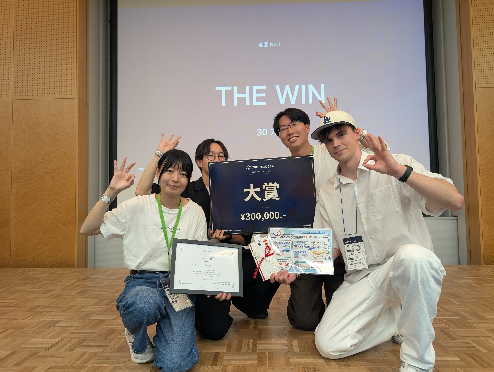
  <br>
  <sub>THE HACK 2026 本戦（大阪）で大賞を受賞したチーム THE WIN</sub>
</div>

## ドキュメント

| 文書 | 内容 |
|:--|:--|
| [システム仕様書](./docs/README.md) | 全体アーキテクチャ、主要機能、仕様書の入口 |
| [Android アプリ仕様書](./docs/android-specification-v1.md) | カメラ、追跡、接続、位置合わせ |
| [Desktop アプリ仕様書](./docs/desktop-specification-v1.md) | 受信、座標変換、ジェスチャー、オーバーレイ |
| [通信仕様書 v1](./docs/protocol-specification-v1.md) | Android / PC 間の WebSocket JSON 契約 |
| [ギャラリー](./docs/gallery.md) | 画面とフローの一覧 |
| [コンテスト応募用文面](./docs/contest-copy.md) | 一言紹介、作品概要、PR ポイント |
| [作業用・履歴資料](./docs/work/README.md) | 要件、設計検討、レビュー、開発記録 |
| [READMEのデザイン](./docs/readme-design.md) | このREADMEの図・YouRay・見出しの動きの考え方 |
| [文字だけのREADME](./README-text.md) | 画像が読み込めないときに読む、同じ内容の文字だけの版 |

## 参考文献

**先行研究**

1. L. Findlater, J. E. Froehlich, K. Fattal, J. O. Wobbrock, T. Dastyar. "Age-Related Differences in Performance with Touchscreens Compared to Traditional Mouse Input." *CHI 2013*. [doi:10.1145/2470654.2470703](https://doi.org/10.1145/2470654.2470703)
2. C. Forlines, D. Wigdor, C. Shen, R. Balakrishnan. "Direct-Touch vs. Mouse Input for Tabletop Displays." *CHI 2007*. [doi:10.1145/1240624.1240726](https://doi.org/10.1145/1240624.1240726)
3. S. A. Brasel, J. Gips. "Tablets, touchscreens, and touchpads: How varying touch interfaces trigger psychological ownership and endowment." *Journal of Consumer Psychology*, 24(2), 2014. [doi:10.1016/j.jcps.2013.10.003](https://doi.org/10.1016/j.jcps.2013.10.003)

**使用技術**

- [MediaPipe Hand Landmarker](https://ai.google.dev/edge/mediapipe/solutions/vision/hand_landmarker)
- [OpenCV ArUco marker detection](https://docs.opencv.org/4.x/d5/dae/tutorial_aruco_detection.html)
- [The WebSocket Protocol — RFC 6455](https://www.rfc-editor.org/rfc/rfc6455)
- [Flutter Desktop](https://docs.flutter.dev/platform-integration/desktop)

## 開発メンバー

**THE WIN**

- 久米蒼輝
- マルチェンコ・ダニール
- 高岡己太朗
- 松本絆那

<picture><source media="(max-width: 700px) and (prefers-color-scheme: dark)" srcset="docs/assets/readme/footer-narrow-dark.svg"><source media="(max-width: 700px)" srcset="docs/assets/readme/footer-narrow-light.svg"><source media="(prefers-color-scheme: dark)" srcset="docs/assets/readme/footer-dark.svg"></picture>
