<h1><picture><source media="(max-width: 1100px) and (prefers-color-scheme: dark)" srcset="docs/assets/readme/title-narrow-dark.svg"><source media="(max-width: 1100px)" srcset="docs/assets/readme/title-narrow-light.svg"><source media="(prefers-color-scheme: dark)" srcset="docs/assets/readme/title-dark.svg"></picture></h1>

Screactは、**タッチ機能のない普通の画面を、手でそのまま操作できるようにするシステム**です。

画面の横にスマホを置き、そのカメラを画面の「目」にします。スマホが手指の動きと画面の位置を認識してPCへ送り、PCがそれをクリック・ドラッグ・スクロール・書き込みに変えます。今あるモニターやプロジェクターを買い替えずに、「操作できる」を後付けします。

<a href="https://drive.google.com/file/d/14SZvVKVLxcpKkB3tEl41TTzPK-4H_XEj/view?usp=sharing"></a>
<a href="https://drive.google.com/file/d/14SZvVKVLxcpKkB3tEl41TTzPK-4H_XEj/view?usp=sharing"><picture><source media="(max-width: 700px) and (prefers-color-scheme: dark)" srcset="docs/assets/readme/video-cta-narrow-dark.svg"><source media="(max-width: 700px)" srcset="docs/assets/readme/video-cta-narrow-light.svg"><source media="(prefers-color-scheme: dark)" srcset="docs/assets/readme/video-cta-dark.svg"></picture></a>

<br>

<picture><source media="(max-width: 700px) and (prefers-color-scheme: dark)" srcset="docs/assets/readme/heads/awards-title-narrow-dark.svg"><source media="(max-width: 700px)" srcset="docs/assets/readme/heads/awards-title-narrow-light.svg"><source media="(prefers-color-scheme: dark)" srcset="docs/assets/readme/heads/awards-title-dark.svg"></picture>

<picture><source media="(max-width: 700px) and (prefers-color-scheme: dark)" srcset="docs/assets/readme/journey-narrow-dark.svg"><source media="(max-width: 700px)" srcset="docs/assets/readme/journey-narrow-light.svg"><source media="(prefers-color-scheme: dark)" srcset="docs/assets/readme/journey-dark.svg"></picture>

<br>

<picture><source media="(max-width: 700px) and (prefers-color-scheme: dark)" srcset="docs/assets/readme/heads/toc-title-narrow-dark.svg"><source media="(max-width: 700px)" srcset="docs/assets/readme/heads/toc-title-narrow-light.svg"><source media="(prefers-color-scheme: dark)" srcset="docs/assets/readme/heads/toc-title-dark.svg">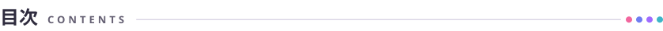</picture>

<p>
<a href="#製品概要"><picture><source media="(max-width: 700px) and (prefers-color-scheme: dark)" srcset="docs/assets/readme/heads/toc-part-1-narrow-dark.svg"><source media="(max-width: 700px)" srcset="docs/assets/readme/heads/toc-part-1-narrow-light.svg"><source media="(prefers-color-scheme: dark)" srcset="docs/assets/readme/heads/toc-part-1-dark.svg">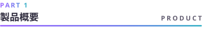</picture></a> <a href="#開発技術"><picture><source media="(max-width: 700px) and (prefers-color-scheme: dark)" srcset="docs/assets/readme/heads/toc-part-2-narrow-dark.svg"><source media="(max-width: 700px)" srcset="docs/assets/readme/heads/toc-part-2-narrow-light.svg"><source media="(prefers-color-scheme: dark)" srcset="docs/assets/readme/heads/toc-part-2-dark.svg">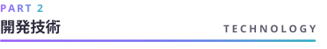</picture></a><br>
<a href="#背景"><picture><source media="(max-width: 700px) and (prefers-color-scheme: dark)" srcset="docs/assets/readme/heads/toc-01-narrow-dark.svg"><source media="(max-width: 700px)" srcset="docs/assets/readme/heads/toc-01-narrow-light.svg"><source media="(prefers-color-scheme: dark)" srcset="docs/assets/readme/heads/toc-01-dark.svg"></picture></a> <a href="#システム構成"><picture><source media="(max-width: 700px) and (prefers-color-scheme: dark)" srcset="docs/assets/readme/heads/toc-09-narrow-dark.svg"><source media="(max-width: 700px)" srcset="docs/assets/readme/heads/toc-09-narrow-light.svg"><source media="(prefers-color-scheme: dark)" srcset="docs/assets/readme/heads/toc-09-dark.svg"></picture></a><br>
<a href="#製品説明"><picture><source media="(max-width: 700px) and (prefers-color-scheme: dark)" srcset="docs/assets/readme/heads/toc-02-narrow-dark.svg"><source media="(max-width: 700px)" srcset="docs/assets/readme/heads/toc-02-narrow-light.svg"><source media="(prefers-color-scheme: dark)" srcset="docs/assets/readme/heads/toc-02-dark.svg"></picture></a> <a href="#活用した技術"><picture><source media="(max-width: 700px) and (prefers-color-scheme: dark)" srcset="docs/assets/readme/heads/toc-10-narrow-dark.svg"><source media="(max-width: 700px)" srcset="docs/assets/readme/heads/toc-10-narrow-light.svg"><source media="(prefers-color-scheme: dark)" srcset="docs/assets/readme/heads/toc-10-dark.svg"></picture></a><br>
<a href="#できること"><picture><source media="(max-width: 700px) and (prefers-color-scheme: dark)" srcset="docs/assets/readme/heads/toc-03-narrow-dark.svg"><source media="(max-width: 700px)" srcset="docs/assets/readme/heads/toc-03-narrow-light.svg"><source media="(prefers-color-scheme: dark)" srcset="docs/assets/readme/heads/toc-03-dark.svg"></picture></a> <a href="#クイックスタート"><picture><source media="(max-width: 700px) and (prefers-color-scheme: dark)" srcset="docs/assets/readme/heads/toc-11-narrow-dark.svg"><source media="(max-width: 700px)" srcset="docs/assets/readme/heads/toc-11-narrow-light.svg"><source media="(prefers-color-scheme: dark)" srcset="docs/assets/readme/heads/toc-11-dark.svg"></picture></a><br>
<a href="#特長"><picture><source media="(max-width: 700px) and (prefers-color-scheme: dark)" srcset="docs/assets/readme/heads/toc-04-narrow-dark.svg"><source media="(max-width: 700px)" srcset="docs/assets/readme/heads/toc-04-narrow-light.svg"><source media="(prefers-color-scheme: dark)" srcset="docs/assets/readme/heads/toc-04-dark.svg"></picture></a> <a href="#ドキュメント"><picture><source media="(max-width: 700px) and (prefers-color-scheme: dark)" srcset="docs/assets/readme/heads/toc-12-narrow-dark.svg"><source media="(max-width: 700px)" srcset="docs/assets/readme/heads/toc-12-narrow-light.svg"><source media="(prefers-color-scheme: dark)" srcset="docs/assets/readme/heads/toc-12-dark.svg"></picture></a><br>
<a href="#利用場面"><picture><source media="(max-width: 700px) and (prefers-color-scheme: dark)" srcset="docs/assets/readme/heads/toc-05-narrow-dark.svg"><source media="(max-width: 700px)" srcset="docs/assets/readme/heads/toc-05-narrow-light.svg"><source media="(prefers-color-scheme: dark)" srcset="docs/assets/readme/heads/toc-05-dark.svg"></picture></a><br>
<a href="#直接操作の価値"><picture><source media="(max-width: 700px) and (prefers-color-scheme: dark)" srcset="docs/assets/readme/heads/toc-06-narrow-dark.svg"><source media="(max-width: 700px)" srcset="docs/assets/readme/heads/toc-06-narrow-light.svg"><source media="(prefers-color-scheme: dark)" srcset="docs/assets/readme/heads/toc-06-dark.svg"></picture></a><br>
<a href="#注力したこと"><picture><source media="(max-width: 700px) and (prefers-color-scheme: dark)" srcset="docs/assets/readme/heads/toc-07-narrow-dark.svg"><source media="(max-width: 700px)" srcset="docs/assets/readme/heads/toc-07-narrow-light.svg"><source media="(prefers-color-scheme: dark)" srcset="docs/assets/readme/heads/toc-07-dark.svg"></picture></a><br>
<a href="#今後の展望"><picture><source media="(max-width: 700px) and (prefers-color-scheme: dark)" srcset="docs/assets/readme/heads/toc-08-narrow-dark.svg"><source media="(max-width: 700px)" srcset="docs/assets/readme/heads/toc-08-narrow-light.svg"><source media="(prefers-color-scheme: dark)" srcset="docs/assets/readme/heads/toc-08-dark.svg"></picture></a>
</p>

## <a id="製品概要"></a><picture><source media="(max-width: 700px) and (prefers-color-scheme: dark)" srcset="docs/assets/readme/heads/part-1-narrow-dark.svg"><source media="(max-width: 700px)" srcset="docs/assets/readme/heads/part-1-narrow-light.svg"><source media="(prefers-color-scheme: dark)" srcset="docs/assets/readme/heads/part-1-dark.svg">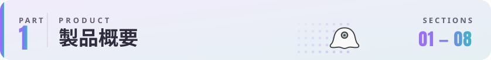</picture>

### <a id="背景"></a><picture><source media="(max-width: 700px) and (prefers-color-scheme: dark)" srcset="docs/assets/readme/heads/play-01-narrow-dark.svg"><source media="(max-width: 700px)" srcset="docs/assets/readme/heads/play-01-narrow-light.svg"><source media="(prefers-color-scheme: dark)" srcset="docs/assets/readme/heads/play-01-dark.svg"></picture>

Screactの出発点は、「プレゼンのとき、画面の前でそのまま操作できたらいいのに」という思いつきでした。説明する人は画面の前にいるのに、スライドを送ったり書き込んだりするたびに、PCの前へ戻らなければなりません。

普通のモニターとマウスでも、説明や会議は成り立ちます。それでも、画面を指し示しながら、その場で書き込み、動かせたら、話はもっと伝わり、もっと一緒に考えられるはずです。画面を直接操作する体験を、特別な機器がなくても、身の回りのどの画面でも味わえるようにしたいと考えました。

<picture><source media="(max-width: 700px) and (prefers-color-scheme: dark)" srcset="docs/assets/readme/message-narrow-dark.svg"><source media="(max-width: 700px)" srcset="docs/assets/readme/message-narrow-light.svg"><source media="(prefers-color-scheme: dark)" srcset="docs/assets/readme/message-dark.svg">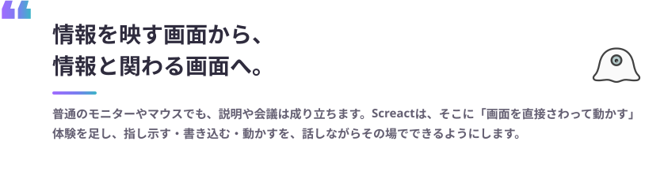</picture>

### <a id="製品説明"></a><picture><source media="(max-width: 700px) and (prefers-color-scheme: dark)" srcset="docs/assets/readme/heads/play-02-narrow-dark.svg"><source media="(max-width: 700px)" srcset="docs/assets/readme/heads/play-02-narrow-light.svg"><source media="(prefers-color-scheme: dark)" srcset="docs/assets/readme/heads/play-02-dark.svg"></picture>

**今ある画面 × スマホ：普通の Screen が、人の動きに React する。**

スマホを画面の横に立てて置き、スマホとPCのアプリでそれぞれボタンを1つ押すだけで準備が整います。スマホがPCを見つけて自動でつながり、画面の四隅に出たマーカーを読んで位置を合わせます。あとは画面の前で手を動かすだけです。

<picture><source media="(max-width: 700px) and (prefers-color-scheme: dark)" srcset="docs/assets/readme/roles-narrow-dark.svg"><source media="(max-width: 700px)" srcset="docs/assets/readme/roles-narrow-light.svg"><source media="(prefers-color-scheme: dark)" srcset="docs/assets/readme/roles-dark.svg">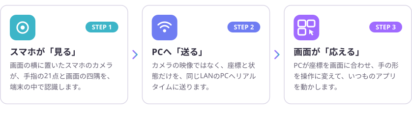</picture>

<picture><source media="(max-width: 700px) and (prefers-color-scheme: dark)" srcset="docs/assets/readme/screens-narrow-dark.svg"><source media="(max-width: 700px)" srcset="docs/assets/readme/screens-narrow-light.svg"><source media="(prefers-color-scheme: dark)" srcset="docs/assets/readme/screens-dark.svg">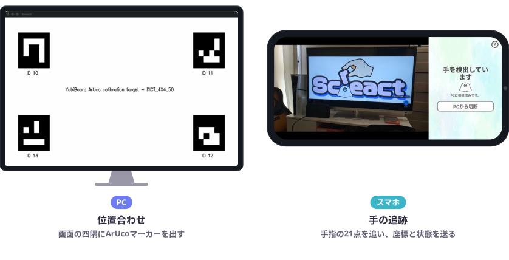</picture>

接続から操作までの、PCとスマホのすべての画面は[ギャラリー](docs/gallery.md)で見られます。名前の **Screact** は、Screen と React を合わせた言葉です。

### <a id="できること"></a><picture><source media="(max-width: 700px) and (prefers-color-scheme: dark)" srcset="docs/assets/readme/heads/play-03-narrow-dark.svg"><source media="(max-width: 700px)" srcset="docs/assets/readme/heads/play-03-narrow-light.svg"><source media="(prefers-color-scheme: dark)" srcset="docs/assets/readme/heads/play-03-dark.svg"></picture>

手の形を読み取り、PCの基本の操作に変えます。描いた線は透明なオーバーレイに重なり、クリックやスクロールはOSの実際の入力として届くので、ブラウザ・スライド・PDFなど、いつものアプリをそのまま動かせます。

<picture><source media="(max-width: 700px) and (prefers-color-scheme: dark)" srcset="docs/assets/readme/gestures-narrow-dark.svg"><source media="(max-width: 700px)" srcset="docs/assets/readme/gestures-narrow-light.svg"><source media="(prefers-color-scheme: dark)" srcset="docs/assets/readme/gestures-dark.svg"></picture>

手を見失ったときや通信が切れたときは、押している途中・描いている途中の状態を自動で解除します。描く色、骨格の表示、認識の感度は、PCの設定画面で変えられます。

### <a id="特長"></a><picture><source media="(max-width: 700px) and (prefers-color-scheme: dark)" srcset="docs/assets/readme/heads/play-04-narrow-dark.svg"><source media="(max-width: 700px)" srcset="docs/assets/readme/heads/play-04-narrow-light.svg"><source media="(prefers-color-scheme: dark)" srcset="docs/assets/readme/heads/play-04-dark.svg"></picture>

画面を直接さわって動かす体験は、電子黒板やタッチディスプレイでも得られます。ただ、それには画面の買い替えが必要で、お金も時間もかかります。Screactは、今ある画面に「操作できる」を後付けします。

<picture><source media="(max-width: 700px) and (prefers-color-scheme: dark)" srcset="docs/assets/readme/features-narrow-dark.svg"><source media="(max-width: 700px)" srcset="docs/assets/readme/features-narrow-light.svg"><source media="(prefers-color-scheme: dark)" srcset="docs/assets/readme/features-dark.svg">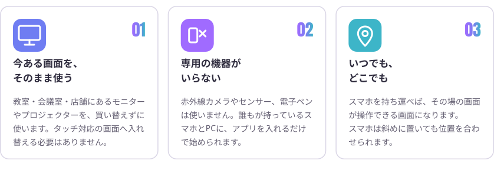</picture>

<picture><source media="(max-width: 700px) and (prefers-color-scheme: dark)" srcset="docs/assets/readme/compare-narrow-dark.svg"><source media="(max-width: 700px)" srcset="docs/assets/readme/compare-narrow-light.svg"><source media="(prefers-color-scheme: dark)" srcset="docs/assets/readme/compare-dark.svg">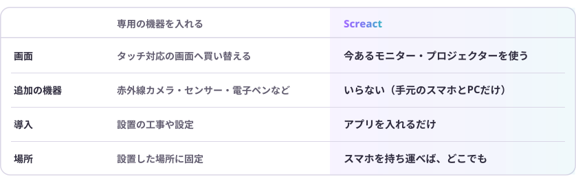</picture>

### <a id="利用場面"></a><picture><source media="(max-width: 700px) and (prefers-color-scheme: dark)" srcset="docs/assets/readme/heads/play-05-narrow-dark.svg"><source media="(max-width: 700px)" srcset="docs/assets/readme/heads/play-05-narrow-light.svg"><source media="(prefers-color-scheme: dark)" srcset="docs/assets/readme/heads/play-05-dark.svg"></picture>

モニターは、教室にも、会議室にも、店舗にもあります。直接操作できる画面は、人と情報、人と人の関わり方を変えます。

<picture><source media="(max-width: 700px) and (prefers-color-scheme: dark)" srcset="docs/assets/readme/scenes-narrow-dark.svg"><source media="(max-width: 700px)" srcset="docs/assets/readme/scenes-narrow-light.svg"><source media="(prefers-color-scheme: dark)" srcset="docs/assets/readme/scenes-dark.svg">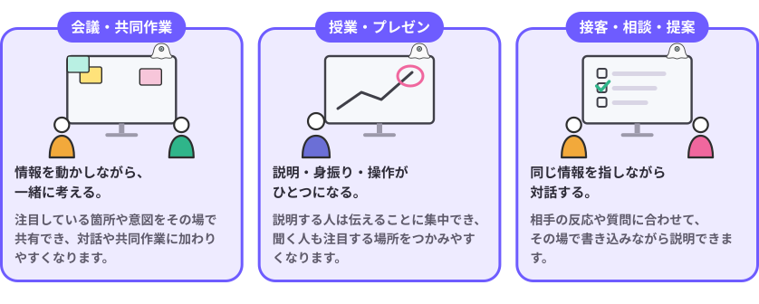</picture>

### <a id="直接操作の価値"></a><picture><source media="(max-width: 700px) and (prefers-color-scheme: dark)" srcset="docs/assets/readme/heads/play-06-narrow-dark.svg"><source media="(max-width: 700px)" srcset="docs/assets/readme/heads/play-06-narrow-light.svg"><source media="(prefers-color-scheme: dark)" srcset="docs/assets/readme/heads/play-06-dark.svg"></picture>

画面を直接操作することの価値は、これまでの研究でも報告されています。直接操作は、操作しやすいだけでなく、操作の意図が周りに伝わりやすくなります。

<picture><source media="(max-width: 700px) and (prefers-color-scheme: dark)" srcset="docs/assets/readme/stats-narrow-dark.svg"><source media="(max-width: 700px)" srcset="docs/assets/readme/stats-narrow-light.svg"><source media="(prefers-color-scheme: dark)" srcset="docs/assets/readme/stats-dark.svg">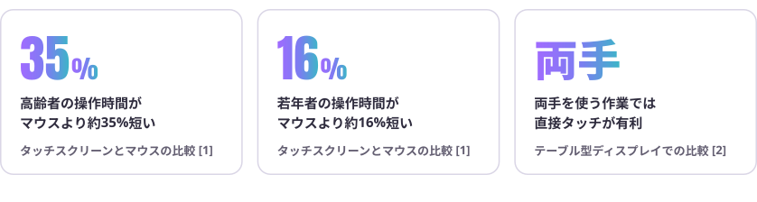</picture>

タッチスクリーンで商品を見たときには、「自分のもの」という感覚が最も強くなり、商品をより高く評価する傾向も報告されています [3]。

> [!NOTE]
> ここで紹介しているのは、一般的な直接操作（タッチスクリーンなど）に関する先行研究の結果です。Screact自体で測った効果ではありません。出典は[参考文献](#参考文献)にあります。

### <a id="注力したこと"></a><picture><source media="(max-width: 700px) and (prefers-color-scheme: dark)" srcset="docs/assets/readme/heads/play-07-narrow-dark.svg"><source media="(max-width: 700px)" srcset="docs/assets/readme/heads/play-07-narrow-light.svg"><source media="(prefers-color-scheme: dark)" srcset="docs/assets/readme/heads/play-07-dark.svg"></picture>

「手を認識できる」だけでは、画面は操作できません。画面のどこを指しているのか、指先の揺れをどう抑えるか、何をしたいのかをどう読み取るか、どうやってアプリに届けるか。認識から操作までを一つの体験としてつなぐために、4つの点に注力しました。

<picture><source media="(max-width: 700px) and (prefers-color-scheme: dark)" srcset="docs/assets/readme/focus-narrow-dark.svg"><source media="(max-width: 700px)" srcset="docs/assets/readme/focus-narrow-light.svg"><source media="(prefers-color-scheme: dark)" srcset="docs/assets/readme/focus-dark.svg"></picture>

### <a id="今後の展望"></a><picture><source media="(max-width: 700px) and (prefers-color-scheme: dark)" srcset="docs/assets/readme/heads/play-08-narrow-dark.svg"><source media="(max-width: 700px)" srcset="docs/assets/readme/heads/play-08-narrow-light.svg"><source media="(prefers-color-scheme: dark)" srcset="docs/assets/readme/heads/play-08-dark.svg"></picture>

<picture><source media="(max-width: 700px) and (prefers-color-scheme: dark)" srcset="docs/assets/readme/roadmap-narrow-dark.svg"><source media="(max-width: 700px)" srcset="docs/assets/readme/roadmap-narrow-light.svg"><source media="(prefers-color-scheme: dark)" srcset="docs/assets/readme/roadmap-dark.svg">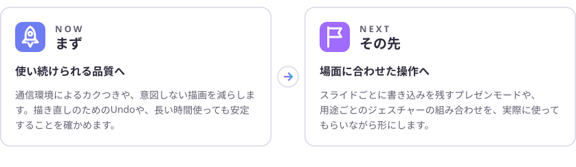</picture>

## <a id="開発技術"></a><picture><source media="(max-width: 700px) and (prefers-color-scheme: dark)" srcset="docs/assets/readme/heads/part-2-narrow-dark.svg"><source media="(max-width: 700px)" srcset="docs/assets/readme/heads/part-2-narrow-light.svg"><source media="(prefers-color-scheme: dark)" srcset="docs/assets/readme/heads/part-2-dark.svg">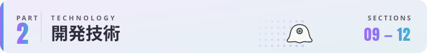</picture>

### <a id="システム構成"></a><picture><source media="(max-width: 700px) and (prefers-color-scheme: dark)" srcset="docs/assets/readme/heads/play-09-narrow-dark.svg"><source media="(max-width: 700px)" srcset="docs/assets/readme/heads/play-09-narrow-light.svg"><source media="(prefers-color-scheme: dark)" srcset="docs/assets/readme/heads/play-09-dark.svg"></picture>

スマホは「見る」役、PCは「操作に変える」役です。カメラの映像はPCへ送らず、スマホの中で認識した座標と状態だけを送ります。通信量を抑えられ、操作の判定はPC側でまとめて調整できます。

<picture><source media="(max-width: 700px) and (prefers-color-scheme: dark)" srcset="docs/assets/readme/architecture-narrow-dark.svg"><source media="(max-width: 700px)" srcset="docs/assets/readme/architecture-narrow-light.svg"><source media="(prefers-color-scheme: dark)" srcset="docs/assets/readme/architecture-dark.svg">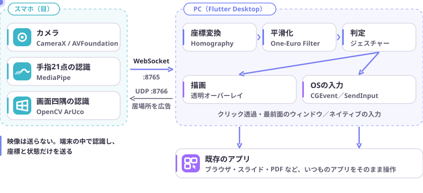</picture>

| 通信 | 既定値 | 役割 |
|:--|--:|:--|
| UDP | `8766` | PCの居場所、WebSocketのポート、6桁コードをスマホへ知らせる（自動発見専用） |
| WebSocket over TCP | `8765` / `/ws/v1/input` | 認証、位置合わせ、手指21点、状態、制御のメッセージ |

手指のデータはUDPでは送りません。メッセージの形式は[通信仕様書 v1](docs/protocol-specification-v1.md)を正本にしています。

### <a id="活用した技術"></a><picture><source media="(max-width: 700px) and (prefers-color-scheme: dark)" srcset="docs/assets/readme/heads/play-10-narrow-dark.svg"><source media="(max-width: 700px)" srcset="docs/assets/readme/heads/play-10-narrow-light.svg"><source media="(prefers-color-scheme: dark)" srcset="docs/assets/readme/heads/play-10-dark.svg"></picture>

<picture><source media="(max-width: 700px) and (prefers-color-scheme: dark)" srcset="docs/assets/readme/techstack-narrow-dark.svg"><source media="(max-width: 700px)" srcset="docs/assets/readme/techstack-narrow-light.svg"><source media="(prefers-color-scheme: dark)" srcset="docs/assets/readme/techstack-dark.svg"></picture>

### <a id="クイックスタート"></a><picture><source media="(max-width: 700px) and (prefers-color-scheme: dark)" srcset="docs/assets/readme/heads/play-11-narrow-dark.svg"><source media="(max-width: 700px)" srcset="docs/assets/readme/heads/play-11-narrow-light.svg"><source media="(prefers-color-scheme: dark)" srcset="docs/assets/readme/heads/play-11-dark.svg"></picture>

**必要なもの**

- Android 7.0（API 24）以上のスマホ（背面カメラ）
- macOS 10.15以上、またはWindowsのPC
- スマホとPCが互いに通信できる、同じLAN（Wi-Fi）
- 開発環境：Flutter（Dart SDK `^3.7.2`）、Android Studio（Android SDK 36、JDK 17）。macOSはフル版のXcode、WindowsはVisual Studioの「Desktop development with C++」

**1. PCのアプリを起動する**

```bash
cd desktop
flutter pub get
flutter run -d macos     # Windows では -d windows
```

macOSでは、初めて接続するときにローカルネットワークへのアクセスを許可してください。クリックやスクロールを使うには、「システム設定」→「プライバシーとセキュリティ」→「アクセシビリティ」でScreactを許可します。

**2. スマホのアプリを入れる**

```bash
cd android
./gradlew assembleDebug          # Windows では .\gradlew.bat assembleDebug
adb install -r app/build/outputs/apk/debug/app-debug.apk
```

Android Studioで開くときは、リポジトリ全体ではなく `android/` を開いてください。iOS版（実験的）は[ios/README.md](ios/README.md)を参照してください。

**3. つないで、合わせて、操作する**

1. PCの画面全体と手が映る位置に、スマホを固定する（斜めからでも構いません）
2. スマホでScreactを起動し、「画面認識開始」を押す
3. PCでScreactを起動し、「はじめる」を押す（スマホがPCを見つけて、自動でつながります）
4. つながると、PCの画面の四隅にマーカーが出て、スマホが読み取って位置を合わせます
5. 位置合わせが終わると、透明なオーバーレイに切り替わります。手で操作を始めてください

自動でつながらないときは、スマホの「手動で接続する（IP・6桁コード）」から、PCの画面に出ているIP・ポート・6桁コードを入力してください。オーバーレイの解除は、macOSではメニューバーの鉛筆のアイコンか `⌘⇧O`、Windowsでは `Ctrl+Shift+O` です。

<details>
<summary><b>テスト</b></summary>

```bash
# Desktop
cd desktop
dart format --output=none --set-exit-if-changed lib test
flutter analyze
flutter test

# Android
cd android
./gradlew testDebugUnitTest lintDebug assembleDebug
./gradlew connectedDebugAndroidTest   # 実機またはエミュレーターが必要
```

</details>

<details>
<summary><b>対応状況と既知の制約</b></summary>

| 対象 | 状態 |
|:--|:--|
| Android + macOS | 主な経路。発表と展示で使用 |
| Android + Windows | 透明オーバーレイと、SendInputによるネイティブ入力を実装。特定の環境の実機で確認済み |
| iOS | 実験段階。iPhoneとmacOSの自動接続は実機で確認済み。手とマーカーの認識にはCocoaPodsの導入が必要 |

- 自動発見はUDPのブロードキャストを使うため、VPN、ゲストWi-Fi、AP isolation、ファイアウォールなどの環境では失敗することがあります。そのときは手動接続を使ってください。
- PCが同時に受け付けるスマホは1台です。
- 位置合わせの結果は、PCのアプリを終了すると消えます。
- 通信は、信頼できる同じLANでの利用を前提とした、暗号化なしのWebSocketです。
- 単眼のカメラなので、画面に指が触れた瞬間は検出しません。つまむなどのジェスチャーで、操作の意思を表します。
- 手による拡大・縮小のジェスチャーは、まだありません。

</details>

### <a id="ドキュメント"></a><picture><source media="(max-width: 700px) and (prefers-color-scheme: dark)" srcset="docs/assets/readme/heads/play-12-narrow-dark.svg"><source media="(max-width: 700px)" srcset="docs/assets/readme/heads/play-12-narrow-light.svg"><source media="(prefers-color-scheme: dark)" srcset="docs/assets/readme/heads/play-12-dark.svg"></picture>

| 文書 | 内容 |
|:--|:--|
| [システム仕様書](docs/README.md) | 全体のアーキテクチャ、主な機能、仕様書の入口 |
| [Androidアプリ仕様書](docs/android-specification-v1.md) | カメラ、追跡、接続、位置合わせ |
| [Desktopアプリ仕様書](docs/desktop-specification-v1.md) | 受信、座標変換、ジェスチャー、オーバーレイ |
| [通信仕様書 v1](docs/protocol-specification-v1.md) | AndroidとPCのあいだのWebSocket JSONの契約 |
| [ギャラリー](docs/gallery.md) | 画面とフローの一覧、受賞写真 |
| [READMEのデザイン](docs/readme-design.md) | このREADMEの見出し・図・YouRayの演出の考え方 |
| [文字だけのREADME](README-text.md) | 画像が読み込めないときに読む、同じ内容の文字だけの版 |

<a id="参考文献"></a>**参考文献**

1. L. Findlater, J. E. Froehlich, K. Fattal, J. O. Wobbrock, T. Dastyar. "Age-Related Differences in Performance with Touchscreens Compared to Traditional Mouse Input." *CHI 2013*. [doi:10.1145/2470654.2470703](https://doi.org/10.1145/2470654.2470703)
2. C. Forlines, D. Wigdor, C. Shen, R. Balakrishnan. "Direct-Touch vs. Mouse Input for Tabletop Displays." *CHI 2007*. [doi:10.1145/1240624.1240726](https://doi.org/10.1145/1240624.1240726)
3. S. A. Brasel, J. Gips. "Tablets, touchscreens, and touchpads: How varying touch interfaces trigger psychological ownership and endowment." *Journal of Consumer Psychology*, 24(2), 2014. [doi:10.1016/j.jcps.2013.10.003](https://doi.org/10.1016/j.jcps.2013.10.003)

使用した技術の資料：[MediaPipe Hand Landmarker](https://ai.google.dev/edge/mediapipe/solutions/vision/hand_landmarker) ／ [OpenCV ArUco](https://docs.opencv.org/4.x/d5/dae/tutorial_aruco_detection.html) ／ [RFC 6455（WebSocket）](https://www.rfc-editor.org/rfc/rfc6455) ／ [Flutter Desktop](https://docs.flutter.dev/platform-integration/desktop)

**開発メンバー**：THE WIN（久米蒼輝・マルチェンコ・ダニール・高岡己太朗・松本絆那）

<br>

<picture><source media="(max-width: 700px) and (prefers-color-scheme: dark)" srcset="docs/assets/readme/footer-narrow-dark.svg"><source media="(max-width: 700px)" srcset="docs/assets/readme/footer-narrow-light.svg"><source media="(prefers-color-scheme: dark)" srcset="docs/assets/readme/footer-dark.svg"></picture>
