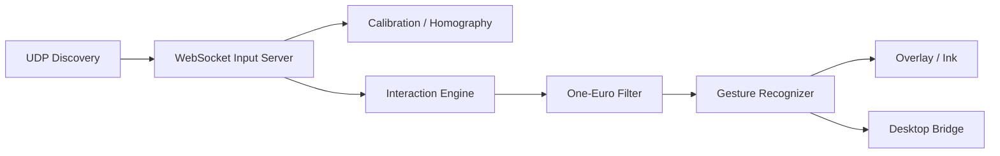

# Screact Desktop アプリ仕様書

> **Version:** 1.0.0 
> **基準コミット:** `4f2d1e5`（2026-08-22） 
> **対象:** THE HACK 2026 Team 35「THE WIN」 / Screact Desktop

## 📑 目次

- [はじめに](#はじめに)
- [システム概要](#システム概要)
- [モジュール構成](#モジュール構成)
- [接続と処理フロー](#接続と処理フロー)
- [操作とオーバーレイ](#操作とオーバーレイ)
- [設定](#設定)
- [OS連携](#os連携)
- [検証](#検証)
- [更新履歴](#更新履歴)

## はじめに

### 文書情報

| 項目 | 内容 |
| --- | --- |
| 文書種別 | 現行実装仕様（As-Built Specification） |
| 対象 | Screact Desktop アプリ |
| 実装基準 | `4f2d1e5`（THE HACK 2026 本戦版） |
| 最終更新日 | 2026-08-30 |

Desktop アプリは、Android から受け取った位置合わせ結果と手指ランドマークを、PC画面上のポインター、描画、操作イベントへ変換する処理主体です。Flutter/Dart の共通層に、macOS/Windows のネイティブウィンドウ・入力連携を組み合わせます。

## システム概要

### アーキテクチャ

### 主要機能

| 領域 | 実装内容 |
| --- | --- |
| 接続 | UDP `8766` で接続情報を広告し、WebSocket `8765/ws/v1/input` を待ち受ける。 |
| 認証 | 初回は6桁 `pairingToken`、再接続は `resumeToken` を用いる。詳細は [通信仕様書 v1](./protocol-specification-v1.md)。 |
| 座標処理 | 4点の ArUco 結果から Homography を計算し、手の座標を画面座標へ変換する。 |
| 操作判定 | ポインター、ピンチクリック、ドラッグ、描画、グー消しゴム、グッドサイン・スクロールをイベント化する。 |
| 描画 | 色選択・骨格表示を持つ操作画面と、透明・クリック透過のオーバーレイを提供する。 |
| 設定 | 認識感度、手ブレ補正、骨格表示、ジェスチャーの個別 ON/OFF、位置合わせ詳細設定、ポート番号を変えられる。詳細は [設定](#設定)。 |

## モジュール構成

| パス | 責務 |
| --- | --- |
| `desktop/lib/net/` | UDP 発見、WebSocket サーバー、接続状態 |
| `desktop/lib/core/` | Homography、平滑化、ジェスチャー、操作状態 |
| `desktop/lib/ui/` | 接続、位置合わせ、オーバーレイ操作、設定画面 |
| `desktop/lib/platform/` | Flutter とネイティブ機能の境界 |
| `desktop/macos/` / `desktop/windows/` | 透過ウィンドウ、OS 固有の実装 |

## 接続と処理フロー

1. Desktop が接続情報と6桁コードを UDP で広告する。
2. Android が WebSocket 接続し、`hello` / `hello_ack` でセッションを確立する。
3. Desktop が配置確認後に ArUco マーカーを表示し、Android の4点結果から変換行列を作る。
4. `hand_frame` を受信し、最新フレームを優先して平滑化・座標変換・ジェスチャー判定を行う。
5. 判定結果をオーバーレイ描画または OS 入力へ反映する。

メッセージのフィールドとエラー契約は、必ず [通信仕様書 v1](./protocol-specification-v1.md) を参照する。

## 操作とオーバーレイ

位置合わせ完了後は透明・最前面・クリック透過のオーバーレイへ移行します。macOS ではメニューバーまたは `⌘⇧O`、Windows では `Ctrl+Shift+O` で解除でき、切断時にも安全に解除します。

| ジェスチャー | Desktop のイベント |
| --- | --- |
| 人差し指移動 | ポインター移動 |
| ピンチ | クリック / 継続時はドラッグ |
| 人差し指・中指の近接 | 描画 |
| グー | 描画消去 |
| グッドサインの上下移動 | 縦スクロール |

## 設定

設定画面（`desktop/lib/ui/home_page.dart` の `_settingsScreen`）で、次の項目を変えられます。項目名は画面の表記です。

### 項目と既定値

| 項目（画面の表記） | 内容 | 既定値 | 反映のタイミング | 再起動後 |
| --- | --- | --- | --- | --- |
| IPアドレス | この PC の Wi-Fi の IP アドレス。表示だけで編集できない。右の再取得ボタン（ツールチップ「Wi-Fi IPを再取得」）で取り直す | 自動取得 | - | - |
| ポート番号 | WebSocket の待ち受けポート（1〜65535） | `8765`（ビルド時の `YUBI_PORT` で変更できる） | 「保存」を押したとき。接続中は次の接続から | 残らない |
| 認識感度 | ピンチと描画の接触判定のしきい値。0〜100 で表示する（内部値は 0〜1） | 50（内部値 0.5） | 「保存」を押したとき | 残らない |
| 手ブレ補正 | 画面座標に One-Euro フィルターをかけるかどうか | ON | 「保存」を押したとき | 残らない |
| 詳細設定（位置合わせ詳細設定） | 下の「位置合わせ詳細設定」を参照 | 下の表 | ダイアログの「設定に反映」で下書きに入り、設定画面の「保存」を押したとき | 残らない |
| 骨格を表示 | 手のランドマーク（骨格）をオーバーレイに重ねるかどうか | OFF | 切り替えた時点。OFF にすると表示中の骨格もすぐ消す | 残る（`show_skeleton`） |
| ハンドジェスチャー（個別設定） | クリック、ペン（描画）、消しゴム、スクロールを個別に ON/OFF する。設定画面には「n/4 ON」と ON の数を出す | すべて ON | 切り替えた時点 | 残る（`gesture_toggles`） |

- 「保存」を押した項目も、アプリのメモリ上にあるだけです。再起動すると既定値に戻ります。
- 「初期化」を押すと、上の項目をすべて既定値に戻します。骨格表示とジェスチャー個別設定は、既定値をファイルにも書き込みます。
- macOS でアクセシビリティが許可されていないときは、設定画面に案内と「アクセシビリティを許可」ボタンを出します。

### 骨格表示を切り替えられる場所

骨格表示は、次の 3 か所から切り替えられます。どこで切り替えても同じ設定が変わり、すぐにファイルへ保存します。

| 場所 | 画面の表記 |
| --- | --- |
| 設定画面 | 骨格を表示 |
| ワークスペース（描画色の右） | 骨格表示 |
| 「接続情報」ダイアログ | 骨格を表示 |

### ハンドジェスチャーの個別設定

設定画面の「個別設定」を押すと「ハンドジェスチャー」ダイアログが開きます。OFF にしたジェスチャーは認識せず、その手は判定の優先順位で次のジェスチャーへ回します。ほかに当たるものが無ければ、ポインター移動として扱います。

| 画面の表記 | 対応する操作 |
| --- | --- |
| クリック | 親指と人差し指でつまむ（OS のクリック・ドラッグ） |
| ペン（描画） | 人差し指と中指をくっつけて線を描く |
| 消しゴム | 手をグーにして線を消す |
| スクロール | グッドサイン（親指を立てる）で親指の向きにスクロール |

### 位置合わせ詳細設定

設定画面の「手ブレ補正」の右にある「詳細設定」を押すと「位置合わせ詳細設定」ダイアログが開きます。各項目の意味は [通信仕様書 v1 のマーカーインセット補正](./protocol-specification-v1.md#マーカーインセット補正pc側設定値) を参照してください。

| 画面の表記 | 既定値 | 入力できる範囲 |
| --- | --- | --- |
| マーカー内側率X % | 12.50 | 0〜45 |
| マーカー内側率Y % | 22.22 | 0〜45 |
| 四隅内側率X % | 0.00 | 0〜45 |
| 四隅内側率Y % | 0.00 | 0〜45 |
| 安定メッセージ数 | 1 | 1〜30 |
| 使用メッセージ | 両方 | 両方 / ArUcoのみ / 四隅のみ |

範囲外の値や数値でない入力は採用せず、直前の値を保ちます。

### 保存先

再起動後も残る項目は、次のディレクトリの下にプレーンテキストで保存します。

| OS | ディレクトリ |
| --- | --- |
| Windows | `%LOCALAPPDATA%\yubiboard\`（`LOCALAPPDATA` が無ければ `%APPDATA%\yubiboard\`） |
| macOS | `~/Library/Application Support/yubiboard/` |
| その他（Linux など） | `$XDG_CONFIG_HOME/yubiboard/`（未設定なら `~/.config/yubiboard/`） |

| ファイル | 内容 |
| --- | --- |
| `show_skeleton` | 骨格表示が ON なら `1`、OFF なら `0` |
| `gesture_toggles` | クリック、ペン、消しゴム、スクロールの順に `1`（ON）か `0`（OFF）を並べた 4 文字。例: `1101` は消しゴムだけ OFF |

ファイルが無いときや読めないときは既定値を使います。書き込みに失敗しても、アプリはそのまま動きます（次の起動では既定値に戻ります）。

## OS連携

| OS | 透明オーバーレイ | ネイティブ OS 入力 |
| --- | --- | --- |
| macOS | 実装済み | Swift / CGEvent で実装済み。アクセシビリティ許可が必要。 |
| Windows | 実装済み | C++ / Win32 `SendInput` で実装済み。特定の Windows + Android 実機で描画、クリック/ドラッグ、消しゴム、スクロールを確認済み。UIPI、対象アプリ、権限によって結果が変わり得る。 |

## 検証

コアの単体・Widget・接続・位置合わせテストは `desktop/test/` にある。実行コマンド、実機確認の範囲、既知の制約は [開発台帳](./work/records/product/Screact_プロダクト・開発台帳_2026-08-30.md) を確認する。

## 📚 更新履歴

| 日付 | Version | 内容 |
| --- | --- | --- |
| 2026-08-30 | 1.0.0 | 基準コミットの Desktop 実装をまとめた初版 |
