# Screact READMEのデザイン

[製品紹介](../README.md) ／ [文字だけのREADME](../README-text.md) ／ [README用の図版](assets/readme/README.md) ／ [ギャラリー](gallery.md)

ScreactのREADMEは、見出し・目次・図の1枚1枚まで作り込んでいます。この資料は、何を狙い、どう判断したかを、**判断の理由**を中心にまとめたものです。

仕組みは、同じ作者が手がけた [Re:Cooplay（jphacks/kz_2613）のREADME](https://github.com/jphacks/kz_2613) を土台にしています。ライト・ダーク × PC・スマホの4種類の画像、文章 → 図の並べ方、枠線だけのカード、グラデーションの数字、見出しの横で演じるキャラクター、文字だけのREADMEは、kz_2613 の [READMEのデザイン](https://github.com/jphacks/kz_2613/blob/main/docs/readme-design.md) の考え方をそのまま受け継ぎました。この資料では、Screactに合わせて変えたところを中心に書きます。

## 1. いちばんの狙い：「ぱっと見ふつう」から「えええ」へ

kz_2613 と同じく、**驚きを段階的に大きくする**ように作っています。

1. 開いた瞬間は、ありきたりな製品紹介のREADMEに見えます。作品名の見出しも、GitHubでいつも見る見た目です。
2. 概要文を読んでいると、見出しの「r」がつままれて持ち上がり、すき間から YouRay が顔を出します。
3. 下へ読み進めると、受賞の道のりを進む YouRay、見出しごとの小さな劇、実際の画面、流れる点で動きが分かる構成図が続きます。

Screactは「普通の Screen が、人の動きに React する」製品です。**ふつうの見出しだと思っていたものが、手の動きに反応して動き出す**こと自体が、製品の体験そのものになるようにしました。

## 2. 作品名の見出し（h1）：ロゴの場面を、見出しの文字で演じる

<table><tr><th align="left">画像1　作品名の見出し（約4.5秒後に動き出す）<br><sub>READMEで使っている画像の実物：<code>docs/assets/readme/title-*.svg</code></sub></th></tr><tr><td><picture><source media="(max-width: 1100px) and (prefers-color-scheme: dark)" srcset="assets/readme/title-narrow-dark.svg"><source media="(max-width: 1100px)" srcset="assets/readme/title-narrow-light.svg"><source media="(prefers-color-scheme: dark)" srcset="assets/readme/title-dark.svg"></picture></td></tr></table>

### 2.1 物語

Screactのロゴは、手が「Screact」の「r」をつまみ上げ、その下から YouRay がのぞく絵です。見出しでは、この絵を見出しの文字で演じます。

1. ロゴの手が上から来て、「r」をつまんで持ち上げます（つまむ＝クリック、持ち上げる＝ドラッグ）。
2. すき間から YouRay が顔を出し、驚き、左右を見て、うれしそうに目を細めます。
3. YouRay が外へ出ると、手は「r」を元へ戻します。
4. 手はキャッチコピーの「操作できる」をペンで丸く囲みます（描く）。YouRay が喜び、きらきらが弾けます。
5. 手は丸をなぞって消し（消す）、みんな去って、元の見出しに戻ります。

- **製品の4つの操作を、すべて見出しの中で見せています。** つまむ・動かす・描く・消すは、どれも Screact のジェスチャーです。
- **見出しの文字を素材にします。** 「r」はロゴでも持ち上がっている字です。ふつうの見出しの1文字が動くので、「見出しだと思っていたもの」が動いた驚きが強くなります。
- **終わったら完全に元の見出しに戻ります。** 何度見ても、ふつうの見出しから始まります。

### 2.2 錯覚を成立させる工夫

| 工夫 | 理由 |
|---|---|
| 文字はGitHub本体と同じフォント指定・大きさ・太さ（作品名はh1の32px、キャッチコピーはh2と同じ24px、太さ600）で描く | 画像だと気づかれないようにする |
| 1文字ずつの幅は、GitHubと同じフォント指定でChromeが測った値で置く（`title.py` の `WIDTHS`） | 「r」だけを別の要素にしても、字間が不自然にならないようにする |
| `<h1>` の中に `align="absbottom"` で画像を入れる | 見出しの下線までの間隔を、ふつうの見出しと同じにする |
| 一番上に「※技育展2026 決勝での内容です」を、GitHubの引用と同じ見た目で描く | kz_2613 と同じ注釈の形。見出しの上に不自然な余白を作らない |
| YouRay は、見出しの基準線より下を切り抜いた範囲の中で動かす | 「r」のすき間から、地面の下から出てくるように見せる |
| 画面の幅1100px以下では、キャッチコピーを3行に分けたスマホ用に切り替える | GitHubは幅768px以上で本文の横に欄を出し、本文欄が狭くなるため |

### 2.3 動き出す時刻

表示してから約4.5秒は動きません。1周は23秒です。読み手が概要文を読み始めたころに、視界の端で見出しが動き出すようにしています。

## 3. YouRay

YouRay は、Screactのアプリのアイコンとスプラッシュに出てくる、一つ目のゴーストです。READMEでは、kz_2613 の4色のスマホ型キャラクターの役を、YouRay 1体が受け持ちます。

- **形と色はアプリと同じにします。** 体は `#FAFAFA`、輪郭は `#424242`、目の虹彩は `#B4CACA` です（`desktop/assets/production_character.png` と同じ）。SVGで描き直し（`art.py` の `GHOST`）、どの大きさでもくっきり表示します。
- **表情は目だけで作ります。** ふつう・驚き・左右を見る・上を見る・うれしい（目を細める）・閉じる。一つ目なので、目の形を変えるだけで気持ちが伝わります。
- **ゴーストらしく、ふわふわ浮かびます。** ふだんの動きは上下のゆっくりした揺れとまばたきだけにして、読む邪魔をしません。
- **ロゴの手とペアで動きます。** 手はロゴと同じ「つまむ手」です。Screactは手の動きで操作する製品なので、手が操作し、YouRay が反応する、という役割分担にしています。

文章と表には YouRay を置きません。読む場所は読むことに集中してもらうためです。

### 3.1 項目の見出しの横で演じる場面

<table><tr><th align="left">画像2　項目の見出しと、横で内容を演じる YouRay<br><sub>READMEで使っている画像の実物：<code>docs/assets/readme/heads/play-03-*.svg</code></sub></th></tr><tr><td><picture><source media="(max-width: 700px) and (prefers-color-scheme: dark)" srcset="assets/readme/heads/play-03-narrow-dark.svg"><source media="(max-width: 700px)" srcset="assets/readme/heads/play-03-narrow-light.svg"><source media="(prefers-color-scheme: dark)" srcset="assets/readme/heads/play-03-dark.svg"></picture></td></tr></table>

| 番号 | 項目 | 場面 |
|---|---|---|
| 01 | 背景 | ふつうの画面に触ってみるが、何も起きない。「…」と考え込む |
| 02 | 製品説明 | スマホが YouRay の動きを見て、画面のカーソルが同じ形で動く |
| 03 | できること | 画面に線を描き、つぶれて（グー）消し、上へ動いてスクロールする |
| 04 | 特長 | スマホを頭にのせて運び、モニターの横に置くと、画面が光る |
| 05 | 利用場面 | 会議・授業・接客の3つの画面を順にめぐる |
| 06 | 直接操作の価値 | マウスとタッチの棒グラフを見て、タッチの短さに驚いて喜ぶ |
| 07 | 注力したこと | 斜めに置いたスマホが四隅のマーカーを読み、画面の位置が合う |
| 08 | 今後の展望 | 点線の道を跳ねて進み、次の旗が立つ |
| 09 | システム構成 | スマホ → PC → 画面へ流れる座標の点に乗っていく |
| 10 | 活用した技術 | 4色のブロックを積み上げ、一番上に乗る |
| 11 | クイックスタート | 再生ボタンを押すと、つながって画面が使えるようになる |
| 12 | ドキュメント | 本を開いて読む。ページがめくれる |

- 場面の中には文字を置かず、形と動きだけで伝えます。
- 場面は幅560・高さ100の舞台に描き、PCでは見出しの文字の右に0.57倍で、スマホでは番号の行の上に幅いっぱいで置きます。
- 舞台の端は、GitHubの背景色のグラデーションを重ねて溶かします。マスクは iPhone の Safari でぼやけるので使いません（kz_2613 と同じ）。

### 3.2 受賞の道のり

受賞結果は、THE HACK 2026 の予選 → 本戦（大賞）→ 技育博 → 技育展の決勝を、駅をつないだ路線にしています。YouRay が駅から駅へ跳んで進み、着いた駅が光ります。大賞の駅では、きらきらが弾けます。PCは横、スマホは縦の路線にしています。

## 4. 1つの図に4種類の画像を用意する

kz_2613 と同じく、**すべての図にライト・ダーク × PC・スマホの4種類の画像**を用意し、`<picture>` で閲覧者の環境に合う1枚だけを表示します。

| 種類 | ファイル名の末尾 | 画像の幅 | 表示する環境 |
|---|---|---|---|
| PC・ライト | `-light` | 838px | 画面の幅が700pxより広く、ライトのテーマ |
| PC・ダーク | `-dark` | 838px | 画面の幅が700pxより広く、ダークのテーマ |
| スマホ・ライト | `-narrow-light` | 324px | 画面の幅が700px以下で、ライトのテーマ |
| スマホ・ダーク | `-narrow-dark` | 324px | 画面の幅が700px以下で、ダークのテーマ |

- 図はGitHubの本文欄と同じ幅で描き、READMEでは原寸で表示します。図の文字は13px以上にし、`python scripts/readme/check_text_size.py` で確かめます。
- スマホ用の画像は、縮めずに組み替えます。横に並べたカードは縦1列にし、構成図は縦の流れに描き直します。

## 5. 配置

- 冒頭は「作品名の見出し → 概要文 → デモ動画 → 受賞・出展 → 目次」の順です。何の製品か、どう動くか、どう評価されたかが、目次までの短い間に伝わります。
- 本文は、技育展2026 決勝の発表の流れ（後付けのコンセプト → 仕組みと4つの操作 → 既存の画面を使う価値 → 利用場面 → 研究 → 技術の4つのこだわり）に沿って並べています。
- 各項目は「文章 → 図」の順にし、図と図の間に文章を挟みません。

## 6. 色

- **ブランドのグラデーション**は、紫 `#A06BFF` → 青紫 `#7A7EF0` → 青緑 `#3DB5C8` です。ロゴの紫と、アプリのアイコンの青みがかった灰色（`#AEC8D0`）の間をつなぐ色にしました。大きな数字・細い線・矢印・札の縁など、要所にだけ使います。
- **4つの操作の色**は、描く・消す（ピンク `#F2669E`）、クリック（青 `#6F7DF2`）、掴む（紫 `#A06BFF`）、スクロール（青緑 `#3DB5C8`）です。図の中で「どの操作か」を示すときは、必ずこの4色を使います。見出しの区切りの線の右端に並ぶ4つの点も、この4色です。
- 文字の黒は純粋な黒ではなく、紫に寄せた黒（ライト `#2F2C3E`、ダーク `#EEF0F6`）です。

## 7. 文字

| 種類 | 書体 | 使う場所 |
|---|---|---|
| 本文・見出し | GitHub本体と同じフォント指定 | ほぼすべての文字 |
| 数字 | 縦長の表示用書体（Anton の輪郭）＋ブランドのグラデーション | 項目の番号、研究の割合、PARTの番号 |
| 英字ラベル | 13px・太さ600・補助の色・字間を広げる | 「GESTURES」「FOCUS」など |
| 埋め込みフォント | M PLUS Rounded 1c・Yusei Magic（使う字だけに絞る） | 締めのカード |

グラデーションで塗る文字は、iPhone の Safari でぼやけないよう、フォントの輪郭（`<path>`）にして描きます（`scripts/readme/vector.py`。kz_2613 と同じもの）。

## 8. 形と部品

- カードは線の太さ1.5px・角丸14px・塗りなしです。背景を塗らないので、ライト・ダークのどちらの背景にもなじみます。
- アイコンのタイルは、角丸の正方形を操作の色で塗り、白い線のアイコンを載せます。
- 構成図だけは、スマホとPCの範囲を見分けるために、点線の枠とうすい面を敷きます。流れる点（SVGの `animateMotion`）が、手の動きが画面に届くまでの道をたどります。
- **遊びと事実を見た目で分けます。** 実際の画面は、YouRay の形を使わず、ふつうのモニターとスマホの枠に入れます（「製品説明」の実際の画面の図）。

## 9. 動き

- 動き出す前のため（予備動作）と、着地でつぶれ・跳ぶと伸びる動きを入れます。
- 最初は止めておき、にぎやかさは後から来るようにします。
- OSで「視差効果を減らす」を選んだ閲覧者には、すべての動きを止めます。止まった状態でも、元の見出しや完成した図として読めるようにしています。

## 10. 画像が読み込めないときの、文字だけのREADME

リポジトリの直下に、画像を使わず文字だけで読める `README-text.md` を置いています。`scripts/readme/text_readme.py` が `README.md` から作り、`<picture>` を見出し・箇条書きに置き換えます。図の中身は、各SVGの代替テキスト（図と同じデータから書いたもの）から作ります。`README-text.md` は直接編集しません。

## 11. 作り方

図は生成スクリプトから書き出します。SVGは手で直さず、スクリプトを直してから書き出します。

```bash
python scripts/readme/title.py        # 作品名の見出し
python scripts/readme/heads.py        # 項目の見出しと YouRay の場面、大見出し、目次
python scripts/readme/figures.py      # 本文の図
python scripts/readme/text_readme.py  # 文字だけのREADME
python scripts/readme/check_text_size.py
```

- 初回はフォントを `data/local/readme-fonts/`（Git対象外）へ取得します。`fontTools` と `Pillow` が要ります。
- 数値や受賞名、技術の名前を変えるときは、README本文・図・代替テキスト・`README-text.md` をそろえて直します。
- 図に書く事実は、`android/`・`desktop/`・`ios/` のコードと、技育展2026 決勝の発表資料で確かめます。研究の数値は、Screact自体の効果ではないことを本文と図の両方で示します。
- GitHub上で、PCとスマホ、ライトとダークの表示を確かめてから main へ入れます。
